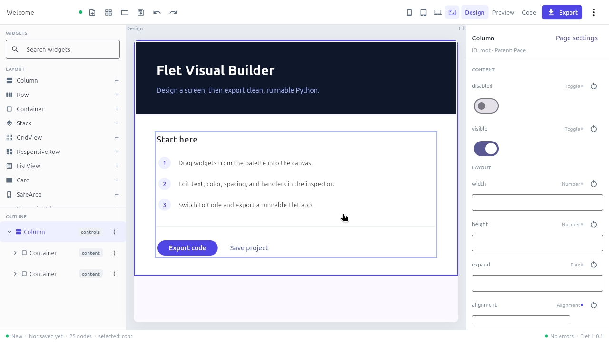
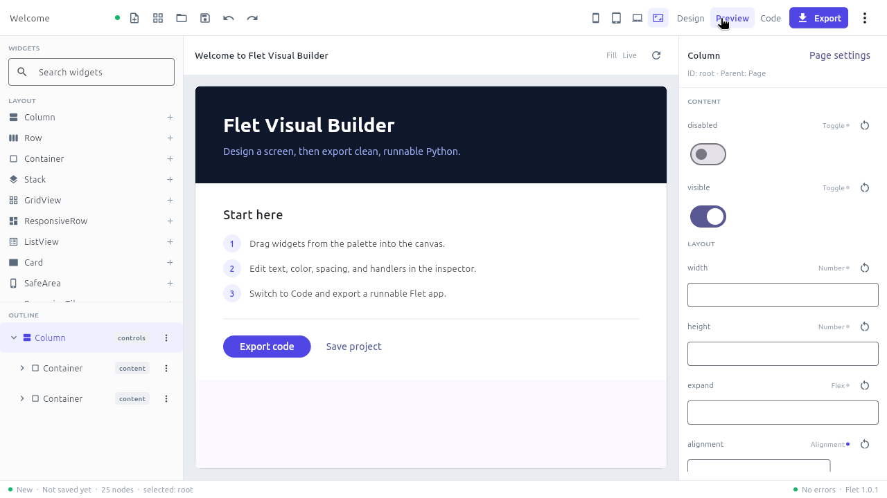
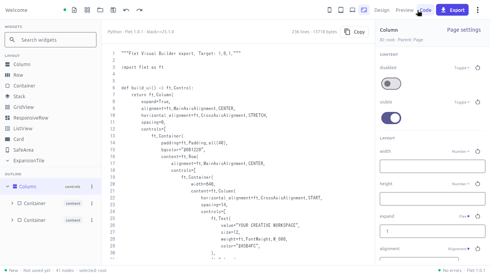
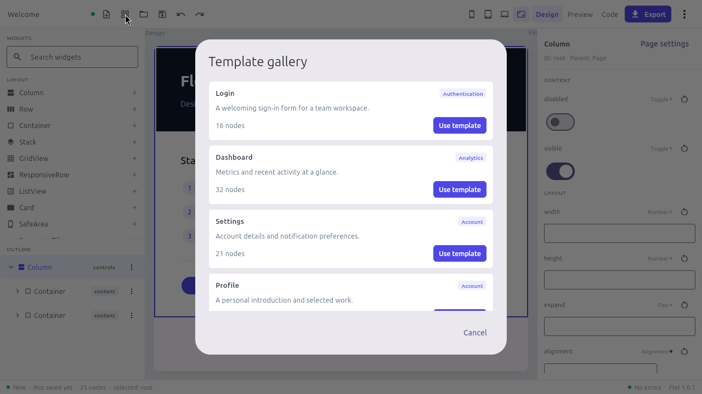

# Flet Visual Builder

Design a Flet interface visually, then export clean Python you own.



Flet Visual Builder is a desktop editor for [Flet](https://flet.dev) apps. Drag widgets
onto a canvas, edit typed properties in an inspector, check the live preview, and export a
runnable `app.py`. The document is a plain JSON file; the output is ordinary Flet code with
no runtime dependency on this project.

## What it does

- **Canvas with real controls.** The canvas renders the actual Flet controls, wrapped in
  selectable frames. Click to select, drag to reorder, drop from the palette to insert.
- **43-widget catalogue.** Layout (`Column`, `Row`, `Container`, `Stack`, `GridView`,
  `ResponsiveRow`, `ListView`, `Card`, `SafeArea`, `ExpansionTile`), text, inputs,
  buttons, display widgets and navigation, each with typed properties and real events.
- **Typed inspector.** Every property is edited through its own control: numbers, toggles,
  enum dropdowns, colour fields with swatches, icon pickers, padding/margin/radius editors,
  borders, plus page-level settings (title, padding, theme, app bar). Reset any property to
  its default with one click.
- **Live preview and device widths.** Preview the document at fill, laptop, tablet and phone
  widths without leaving the editor.
- **Generated Python.** The Code tab shows the export with line numbers, size and target
  versions; copy it or save it as `app.py`.
- **Five designed templates.** Login, Dashboard, Settings, Profile and Onboarding are real
  compositions you can start from and edit, not screenshots.
- **A document model that holds up.** Every edit is a command, so undo/redo is exact.
  Property edits coalesce while typing. The document is validated on every change and the
  diagnostics panel links each problem back to its node.
- **Projects and recovery.** Save/open `.fvb.json`, recent-path memory, and a crash-safe
  autosave that is offered back on the next launch.




## Install

Python 3.11 or newer.

```bash
git clone https://github.com/raffieeey/Flet-Visual-Builder.git
cd Flet-Visual-Builder
python -m venv .venv && source .venv/bin/activate
pip install -e ".[dev]"
```

## Run

```bash
flet-visual-builder                       # desktop window
flet-visual-builder path/to/project.fvb.json
flet-visual-builder --mode code           # open straight in the code view
python -m flet_visual_builder             # same entry point
```

Browser target (optional extra):

```bash
pip install -e ".[web]"
flet-visual-builder --web --port 8000
```

The `web` extra pins FastAPI: `flet-web` 1.0.1 passes `openapi_prefix`, which newer
Starlette releases removed.

## Templates



New documents start from a template gallery. Each template is built from the same catalogue
the editor exposes, so what you see is what you can edit.

## What the export looks like

```python
"""Flet Visual Builder export. Target: 1.0.1."""

import flet as ft


def build_ui() -> ft.Control:
    return ft.Column(
        alignment=ft.MainAxisAlignment.START,
        horizontal_alignment=ft.CrossAxisAlignment.STRETCH,
        spacing=0,
        controls=[
            ft.Container(
                padding=ft.Padding(left=40, top=36, right=40, bottom=36),
                bgcolor="#0F172A",
                content=ft.Column(
                    alignment=ft.MainAxisAlignment.START,
                    horizontal_alignment=ft.CrossAxisAlignment.START,
                    spacing=8,
                    controls=[
                        ft.Text(
                            value="Flet Visual Builder",
                            size=28,
                            weight=ft.FontWeight.BOLD,
                            color="#FFFFFF",
                        ),
                    ],
                ),
            ),
        ],
    )


def main(page: ft.Page) -> None:
    page.title = "Welcome to Flet Visual Builder"
    page.add(build_ui())


if __name__ == "__main__":
    ft.run(main)
```

Event handlers become real function stubs with matching signatures, so wiring behaviour is a
normal Python edit.

## Keyboard shortcuts

| Keys | Action |
| --- | --- |
| `Ctrl/Cmd + Z` | Undo |
| `Ctrl/Cmd + Shift + Z`, `Ctrl/Cmd + Y` | Redo |
| `Ctrl/Cmd + S` | Save |
| `Ctrl/Cmd + O` | Open |
| `Ctrl/Cmd + D` | Duplicate the selection |
| `Delete` / `Backspace` | Delete the selection (ignored while typing in a field) |
| `Esc` | Clear the selection |

## How it is built

```
command  ->  pure reducer  ->  document snapshot  ->  lowering  ->  control plan
                                                   |-> runtime renderer (preview, canvas)
                                                   |-> code generator  (export)
```

- `model/` is a pure command reducer over immutable documents; no Flet import.
- `catalogue/` declares every widget, its typed properties, slots and events.
- `engine/` lowers a document into a control plan and renders or generates code from it.
- `state/` adds undo/redo, revision checks and command coalescing around the reducer.
- `persistence/` handles the JSON format, migrations and assets.
- `ui/` is the editor; `ui/theme.py` holds the design tokens every panel uses.

The separation is enforced by tests: model, catalogue, state and persistence must not import
Flet, and code generation is validated as text (AST + compile), never by executing it.

More detail in [docs/architecture.md](docs/architecture.md).

## Development

```bash
python -m pytest -q          # 576 tests
python -m black --check src tests
```

See [docs/CONTRIBUTING.md](docs/CONTRIBUTING.md) for the module conventions and the verified
Flet 1.0.1 API rules that keep the editor from drifting.

## Project file

`.fvb.json` is a versioned document (`schema_version: 2`) holding the page spec, the node
graph, slots, event bindings and embedded assets. Older 0.x files load through the migration
path.

## Known limits

- One page per document; there is no multi-route navigation editor yet.
- Image sources are URLs or the built-in placeholder; binary asset import is not exposed in
  the UI even though the document model supports it.
- Drop placement is a three-zone model (before / inside / after the hovered node) rather than
  free-form absolute positioning.
- The desktop build is the primary target; the browser build works but has not been tuned for
  phone-sized viewports.

## License

MIT. See [LICENSE](LICENSE).
